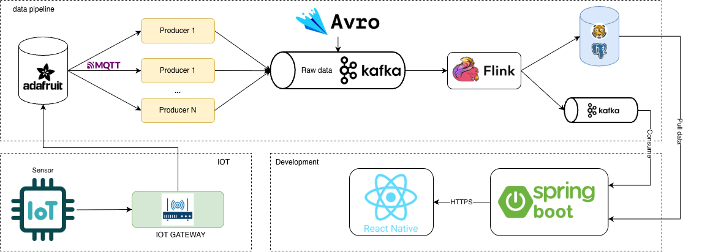

# Smart Farm — Hệ thống giám sát & quản lý nông nghiệp thông minh (IoT)

Hệ thống Smart Farm thu thập dữ liệu cảm biến từ thiết bị IoT, xử lý theo thởi gian thực qua một streaming data pipeline, lưu trữ vào cơ sở dữ liệu time-series, và cung cấp API cho ứng dụng di động React Native để ngườdùng theo dõi vườn, thiết bị, cảnh báo và lập lịch công việc.

## Kiến trúc tổng thể



Hệ thống gồm 4 tầng chính:

| Tầng | Thành phần | Vai trò |
|------|-----------|---------|
| **IoT / Sensor** | Cảm biến (nhiệt độ, độ ẩm không khí, độ ẩm đất) + IoT Gateway | Đo dữ liệu thực địa, publish lên Adafruit IO qua MQTT |
| **Data Pipeline** | Adafruit IO → MQTT/Kafka Bridge (Python) → Kafka (+ Avro/Schema Registry) → Flink (PyFlink) → TimescaleDB + Kafka processed topic | Ingestion, làm sạch, tổng hợp dữ liệu streaming |
| **Backend** | Spring Boot (Java) | REST API, xác thực JWT, quản lý user/garden/device/task/notification, consume dữ liệu đã xử lý từ Kafka, điều khiển thiết bị qua MQTT |
| **Mobile App** | React Native (Expo) | Giao diện ngườdùng, gọi API qua HTTPS, nhận push notification (Expo) |

```
Cảm biến → IoT Gateway → Adafruit IO (MQTT)
   → [data-ingestion.py] MQTT→Kafka Bridge (Avro, Schema Registry)
   → Kafka topic: iot.sensor.raw.v1
   → [data_processing.py] Flink streaming (filter + window 30s + avg/min/max)
   → TimescaleDB (sensor_metrics_30s) + Kafka topic processed
   → Spring Boot consume → REST API → React Native app
```

## Cấu trúc repository

```
smart-farm/
├── image/                 # Sơ đồ kiến trúc
├── be/                    # Backend Spring Boot (Java 17+, Maven)
│   └── src/main/java/hcmut/dadn/be/
│       ├── controller/    # REST controllers (Device, Garden, Task, User, Notification, DeviceToken)
│       ├── service/       # Business logic (interface + impl)
│       ├── models/        # JPA entities (user, garden, device, task, notification, data)
│       ├── repository/    # Spring Data JPA repositories
│       ├── config/        # SecurityConfig, WebSecurityConfig (JWT)
│       ├── dto/           # Request/Response DTOs
│       └── filter/        # JWT auth filter
├── datapipeline/          # Data pipeline (Python, PyFlink)
│   ├── data-ingestion.py  # MQTT → Kafka bridge
│   ├── data_processing.py # Flink streaming job
│   ├── config/            # kafka_producer, mqtt_client, mqtt_kafka_bridge,
│   │                      # etcd_config_manager, avrc_schema, config, logger_config
│   └── docker-compose.yaml# Kafka, Schema Registry, TimescaleDB, etcd, Kafka UI
├── smart-garden/          # Mobile app React Native (Expo, TypeScript)
│   ├── app/               # Expo Router screens
│   ├── components/        # UI components
│   ├── contexts/          # Theme, Notifications, Global state
│   ├── service/           # API clients (auth, garden, task, notification, weather)
│   └── hooks/ utils/      # Hooks & tiện ích
├── docker-compose.yml     # Backend service
└── build.sh               # Script build & deploy backend
```

## 1. Data Pipeline (`datapipeline/`)

### 1.1. Data Ingestion — `data-ingestion.py`

Dịch vụ cầu nối **MQTT → Kafka**:

1. **Etcd Config Manager**: load snapshot cấu hình thiết bị (device_id → mqtt_topic, sensor_type, enabled) từ etcd, và **watch** thay đổi config theo thởi gian thực — thêm/sửa thiết bị sẽ tự subscribe/unsubscribe topic MQTT tương ứng mà không cần restart service.
2. **Kafka Producer** + **Schema Registry** (Avro): serialize message theo schema `SensorData`:
   ```json
   { "device_id": int, "value": double, "sensor_type": string, "timestamp": long, "source": string }
   ```
3. **MQTT Client** kết nối Adafruit IO, nhận message và forward sang Kafka topic `iot.sensor.raw.v1` qua `MQTTKafkaBridge`.

### 1.2. Data Processing — `data_processing.py`

Job **PyFlink** (streaming mode) xử lý dữ liệu raw:

1. **Source**: đọc bytes từ Kafka `iot.sensor.raw.v1`, deserialize Avro qua Schema Registry.
2. **Filter anomaly**: loại bỏ dữ liệu bất thường theo loại cảm biến:
   - `HUMIDITY`, `MOISTURE`: 0–100
   - `TEMPERATURE`: -40–85 °C
3. **Windowing**: event-time với watermark trễ tối đa 5s, tumbling window **30 giây**, key theo `(device_id, sensor_type)`, tính `avg / min / max / count`.
4. **Sink kép**:
   - **TimescaleDB**: insert vào hypertable `sensor_metrics_30s` (chunk 1 ngày, index theo `device_id, time`).
   - **Kafka**: ghi kết quả (JSON) sang processed topic để backend consume.

### 1.3. Hạ tầng pipeline — `datapipeline/docker-compose.yaml`

| Service | Port | Mô tả |
|---------|------|-------|
| `kafka-1` | 19092 | Kafka (KRaft mode, single broker) |
| `schema_registry` | 8081 | Confluent Schema Registry (compatibility: full) |
| `database` | 5432 | TimescaleDB (PostgreSQL 17), DB `smart_farm` |
| `etcd` | 2379/2380 | Lưu cấu hình thiết bị động |
| `kafka-ui` | 8080 | UI quan sát Kafka |

Chạy hạ tầng:

```bash
cd datapipeline
docker compose up -d
```

Cấu hình qua `.env` (xem `.env.example`): `AIO_USERNAME`, `AIO_KEY`, `KAFKA_BOOTSTRAP_SERVERS=localhost:19092`, `KAFKA_TOPIC=iot.sensor.raw.v1`.

Chạy 2 service pipeline:

```bash
python data-ingestion.py    # MQTT → Kafka
python data_processing.py   # Flink job (cần các jar kèm theo: flink-connector-jdbc, postgresql, flink-sql-connector-kafka)
```

## 2. Backend (`be/`) — Spring Boot

REST API chạy tại port `9999`, prefix `/api/v1`:

- **Auth & User**: đăng ký/đăng nhập, JWT access token (15 phút) + refresh token (7 ngày), phân quyền theo `roles`.
- **Garden**: quản lý vườn (tên, loại, giai đoạn cây trồng, địa chỉ theo city/district/ward, thumbnail).
- **Device**: quản lý thiết bị gắn với vườn (tên, loại, trạng thái, đơn vị đo); đồng bộ cấu hình thiết bị với pipeline qua **etcd**; điều khiển thiết bị qua **MQTT Adafruit IO** (đóng/mở van, bơm...).
- **Sensor data**: consume dữ liệu đã tổng hợp từ Kafka processed topic (spring-kafka) và truy vấn TimescaleDB để vẽ biểu đồ.
- **Task**: lập lịch công việc theo vườn.
- **Notification**: lưu thông báo + đẩy push notification qua **Expo Push** (device token lưu ở `user_device_token`).

Công nghệ: Spring Boot (Web, Security, Data JPA, Validation), PostgreSQL/TimescaleDB, spring-kafka, JJWT, Flyway-style migration (`db.migration/V1__init_schema.sql`).

Build & chạy bằng Docker (từ thư mục gốc):

```bash
./build.sh    # Maven package → build image → docker-compose up -d
```

Hoặc chạy trực tiếp:

```bash
cd be && ./mvnw spring-boot:run
```

## 3. Mobile App (`smart-garden/`) — React Native (Expo)

Ứng dụng di động cho ngườdùng cuối:

- **Expo Router** điều hướng; **NativeWind/Tailwind** styling; dark/light theme (`ThemeContext`).
- **TanStack Query** + **axios** gọi REST API backend (auth, garden, task, notification, weather).
- **MQTT trực tiếp** (`@taoqf/react-native-mqtt`) tới Adafruit IO để hiển thị dữ liệu realtime và điều khiển bơm/van.
- **Expo Notifications** nhận push notification từ backend.
- Đa môi trường: `development / staging / production` qua biến `APP_ENV`.

Chạy:

```bash
cd smart-garden
npm install
npm run start:dev    # hoặc android:dev / ios:dev
```

## Luồng dữ liệu end-to-end

1. Cảm biến → IoT Gateway → publish MQTT lên **Adafruit IO**.
2. `data-ingestion.py` subscribe các feed (topic lấy động từ **etcd**), đóng gói thành **Avro** theo schema `SensorData`, đẩy vào Kafka `iot.sensor.raw.v1`.
3. `data_processing.py` (Flink) lọc dữ liệu lỗi, gom cửa sổ 30s, tính avg/min/max/count → ghi **TimescaleDB** + Kafka processed topic.
4. **Spring Boot** consume processed topic, phục vụ REST API, lưu nghiệp vụ (garden/device/task/notification) vào PostgreSQL, gửi push notification, và publish lệnh điều khiển xuống Adafruit IO.
5. **React Native app** gọi API qua HTTPS để hiển thị dashboard vườn/thiết bị/biểu đồ, nhận push notification, và gửi lệnh điều khiển.

## Ports mặc định

| Thành phần | Port |
|------------|------|
| Backend API | 9999 (container map từ 8080) |
| Kafka | 19092 |
| Schema Registry | 8081 |
| TimescaleDB | 5432 |
| etcd | 2379 |
| Kafka UI | 8080 |
